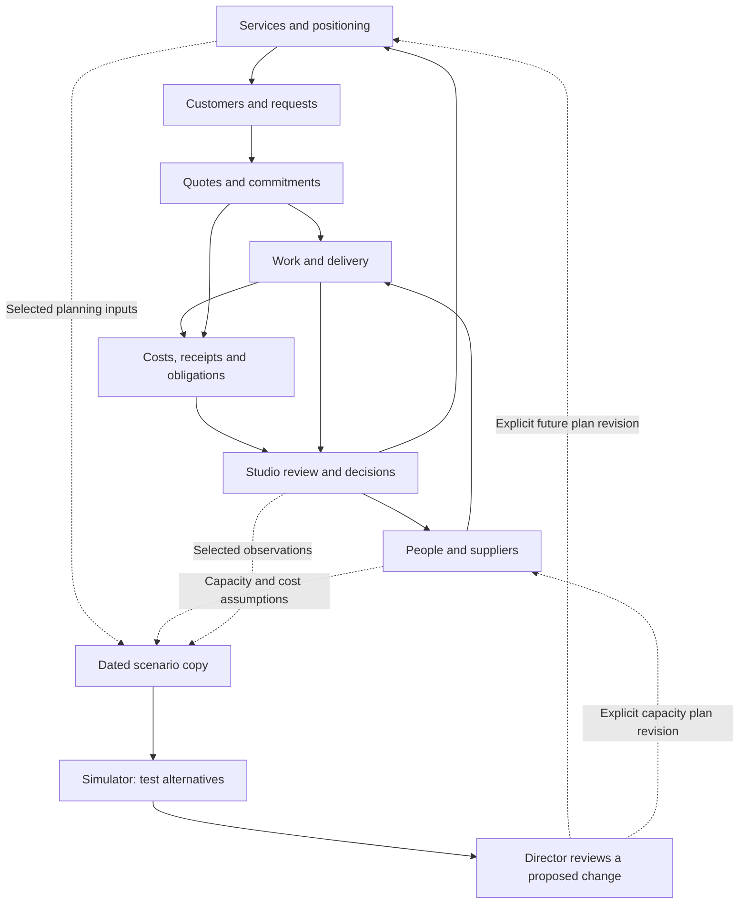

# MEIQQ whole studio expansion plan

Director working plan · 19 November 2026

MEIQQ should help the director define, run and improve an entire studio. Services, customers, people, suppliers, delivery, money and planning belong in one coherent product. The menu example tests one service workflow; it does not define the business or the application architecture.

The director first authorized **Task 1: an offline service ideas launch pad**, and then selected **S1: one actual job end to end** as the next build instead of Task 2. It provides useful example context while leaving the service portfolio open: create any idea, revise its scope, investigate it and compare its estimated economics without first choosing fixed offerings. Task 2 adds the studio capacity/cost baseline and an initial connection to the existing simulator. Remaining tasks add real operating records incrementally.

Director priority: **what the studio can sustainably sell and earn**. Analytics using client business data joins design/print as a candidate service family. The director confirmed partner analytics experience/tools and access to Chinese-language capability, contractors or supplier relationships; specific delivery fit remains offer-dependent. See [Service opportunities and pilot plan](SERVICE-OPPORTUNITIES.md) for the team's shortlist and evidence boundaries.

Status: Task 1 and S1 are implemented on 2026-11-20. Task 1's editable examples are not selected services or customer-validated offers. S1 adds independent real/practice job records, preserved agreements, next actions, work, delivery, costs, receipts, corrections and backup. Task 2 remains queued. The complete breadth of Tasks 3–7 remains proposed; S1 supplies a small useful path through parts of Tasks 3–6, not their full customer/pipeline/purchasing systems.

## The original expansion sequence

The earlier S-series described operating milestones. The later Task-series divided the whole studio by capability; their numbers are not interchangeable.

| Original milestone | Intended outcome | Current position |
|---|---|---|
| S0 — Your studio workflow | Rehearse a representative job in a screen flow | Earlier mockups informed the build |
| S1 — One job end to end | Job entry, next action, work, costs, delivery, payments, corrections and backup | Selected by the director and implemented; see S1-REVIEW.md |
| S2 — Today's studio | Review open jobs, deadlines, approvals, responsibility and balances | Proposed |
| S3 — Better estimates | Compare estimates with recorded time and costs | S1 has a per-job comparison; broader learning remains proposed |
| S4 — Planning informed by records | Deliberately copy selected observations into planning assumptions | Proposed; no automatic connection |
| S5 — Model live workload | Model unfinished commitments and remaining work in an isolated scenario | Future mapping and validation required |

**Task 1** is the completed flexible ideas launch pad. **Task 2** is the separate studio capacity, recurring-expense and earnings baseline with reviewed scenario copies. Choosing S1 does not narrow the studio to menus, analytics or the first paid job; its brief is service-agnostic. It also does not cancel Task 2.

## What exists today

The established application is an offline business simulator. It supports editable offerings, customer/demand assumptions, pooled team capacity, owner time, print fulfillment, simulated commitments, delivery and payment timing, financial analysis, scenario branching, comparisons and local backups. Task 1 adds a separate **Studio ideas** entry for open-ended service exploration; its release checks are recorded below.

The existing service catalog already describes scope, deliverables, revision allowances, print specifications and evidence. Extend these definitions instead of replacing them with another editor. The current engine uses fixed workflow stages; descriptive handoffs added to Studio do not automatically become executable simulation rules.

S1 now holds manually entered client names, accepted job agreements, work, costs and actual receipts. Reusable contacts, opportunities, formal quote/sending stages, purchasing orders and a whole-studio operating view remain future work. A simulated client or receipt is never one of these records.

Source anchors:

- [Current capabilities and limitations](README.md)
- [Existing service definitions](service-catalog.js)
- [Simulator state and event logic](engine.js)
- [Simulator navigation and editors](app.js)
- [Local persistence and conflict handling](storage.js)
- [Simulation workspace validation and backups](workspace.js)
- [Editable Studio example context](studio-seeds.js)
- [Studio idea model and calculations](studio.js)
- [Studio launch pad interface](studio-view.js)
- [Independent Studio persistence](studio-session.js)
- [Existing release validation matrix](STAGE-C.md)

This is the proposed expansion beyond the simulator purpose described in REQUIREMENTS.md. It does not silently rewrite the existing requirements or mark unfinished release checks complete.

## Whole studio map

| Area | Business decisions | Operating records to add | Existing simulator foundation |
|---|---|---|---|
| Services and positioning | What to sell, to whom, with what scope and terms | User-owned offerings, required inputs, roles, delivery checks and versions | Catalog, editable offerings, suitability and unit economics |
| Customers and demand | Which customers to pursue, follow up with and retain | Organizations, contacts, enquiries, opportunity sources and outcomes | Hypothetical clients, inquiries, conversion and repeat behavior |
| Quotes and commitments | What to promise and charge | Intake evidence, estimates, quote versions, acceptance and amendments | Simulated quote decisions and locked commitments |
| People, suppliers and capacity | Who can do the work, when, and with which dependencies | Role/availability plans, assignments, supplier quotes and obligations | Pooled designer capacity, owner time, labor rates and print waits |
| Work and delivery | What needs attention, who owns it and what is blocked | Next actions, due dates, time records, approval and delivery references | Queues, modeled workflow, delays and intervention controls |
| Money | What has been earned, incurred, paid, collected or remains outstanding | Customer receipts, supplier charges/payments, overhead and corrections | Simulated cash, costs, collections and operating results |
| Review and strategy | Which offer, capacity or operating policy to change | Estimate-versus-recorded review and dated planning assumptions | Scenario copies, comparisons and reports |

These are connected responsibilities, not a requirement to build seven empty dashboards.

## Studio and Simulator fit together

**Studio** holds the user's definitions, plans and recorded business activity. An estimate is permitted here, but is labeled as an estimate. A client agreement, incurred cost or receipt must be recorded explicitly with an appropriate date/reference.

**Simulator** holds isolated hypothetical runs. It may start from example assumptions or a dated copy of supported Studio inputs. Its clock and generated events affect that scenario only. Its navigation now says “Run scenario” to distinguish it from actual operating jobs.

Share service vocabulary, suitable editors and calculation functions. Keep operating state, scenario state and their validators separate. Reuse the existing persistence primitives, but do not feed operating records through the simulation validator, which expects a complete simulated daily history.

Use concrete provenance labels: unknown, example assumption, director estimate, supplier quote with date, client agreement with reference, and recorded result with date. Saving a number does not establish its accuracy. Missing actual records must not appear as verified zero cash or zero profit.

A Studio service definition may change for future work. Quote revisions and accepted jobs preserve the exact version of scope and terms they used. A scenario copy records its source version/date and subsequent assumption changes. Simulation results inform a director decision; they do not create receipts, accept quotes or rewrite agreements.

The first planning connection transfers supported configuration inputs: service scope/economics, capacity and cost assumptions. Demand and conversion remain explicit assumptions unless measured. Importing unfinished real jobs into a run is a later, separate task requiring correct remaining-work, commitment, cost and payment mapping.

## Small build tasks

Each task targets one demonstrable capability. If a task needs more than one implementation pass, split the engineering work while keeping the stated completion checks. Avoid another mockup cycle unless a specific unresolved interaction needs one.

### Task 1 — Service ideas launch pad

**Review completed 2026-11-20:** Engineering, experience and business-planning review confirmed the worked analytics workflow and led to fixes for total-team effort visibility, false unchanged-window save conflicts and dialog focus. The reviewed build passes 289 automated checks. See [TASK1-REVIEW.md](TASK1-REVIEW.md) for the walkthrough, remaining usability debt and verification limits. The team recommended the studio baseline at that review; the director subsequently chose S1 first. Task 2 remains queued, with provisional service ideas preserved.

**Result:** The director can save, edit, research and compare possible services in a separate offline workspace. A firm service list, complete price estimate or final delivery process is not required to begin.

**Implementation status:** Delivered in the rebuilt offline `MEIQQ.html` on 2026-11-20. The current build adds **Studio ideas → Service ideas launch pad** alongside the existing simulator. It supports blank ideas and editable examples, idea duplication/deletion, a Scope/Numbers/Research editor and a comparison view. These are planning records, not published offers or accepted quotes.

The examples cover a business-data question, marketing-material refresh, product content, supplier comparison and a later China-market discovery option. All financial and time inputs begin blank. The director may rename, replace or remove these examples and create unrelated ideas; the example families are not a required taxonomy. Origins distinguish editable example context from user-created work. Neither saving an idea nor changing its readiness label establishes buyer demand or delivery capability.

Each idea can describe a possible buyer/problem, scope, deliverables, required inputs, roles, handoffs, completion checks, an earning unit and a next research action. Source notes and URLs are entered manually and remain available offline. Selecting a reference opens the external source in a new browser tab; it does not import findings into the idea. Public links in examples provide context for a workflow or limitation; they are not evidence of the user's prices, demand or supplier terms. Task 1 does not run automated web research, ingest client datasets or implement custom workflow scheduling.

Numbers are planning estimates in USD for paid-role effort/rates, other direct costs, owner time, overhead and setup work. **First engagement** includes preparation once plus one delivery; **Later engagement** excludes that preparation. Both use the same proposed price. Setup is not amortized over assumed sales and there is no separate setup-fee field. Blank inputs remain unknown, and adverse results remain visible. The interface does not project sales volume. There is no market-fit score, automatic price recommendation, accepted quote, cash-flow forecast or guaranteed repeat revenue. The existing simulator's more detailed timing model remains separate.

Studio has its own browser persistence and **Studio backup** JSON export, with an 8 MiB format limit. **Import ideas** validates a Studio backup and adds its ideas as new copies while retaining current ideas. Simulator backups remain separate; neither backup is a combined export of both workspaces. The current model supports up to 500 ideas and 30 paid roles per idea. Storage/recovery messages must remain clear, and unreadable originals must be preserved rather than silently replaced. Automated checks cover these boundaries, including atomic rejection of oversized combined imports.

**Done when:** An arbitrary blank idea and at least two unlike example-derived ideas can be edited, duplicated, compared, saved, reopened and reimported from Studio backup. First/later calculations match entered assumptions; unknowns do not turn into zero or invented earnings. Example origins and current edit-revision metadata survive saving/reopening; the model does not retain a full historical revision log. Manual notes/URLs survive reopening. Import adds new copies without discarding current ideas. Studio operations leave simulator saves and accepted simulated projects unchanged. Appropriate automated, offline browser and keyboard checks pass.

**Depends on:** No later task or fixed service selection. Unresolved amounts remain unknown.

**Verification:** `node --test *.test.cjs` passed all 285 checks. Browser checks covered creation, numeric edits and cent reconciliation, multiline typing, research-note persistence after reload, comparison views, the backup control and a 320px layout without page overflow. Backup contents and additive import round-trips were verified by integration tests; browser download-path observation timed out, so physical download/import-dialog round-trip and new Windows/Edge coverage are not claimed.

**Follow-up request:** “Use the Studio ideas launch pad to refine and compare the ideas I choose. Keep example assumptions and unresolved research visible; do not treat my drafts as active offers or guaranteed sales.”

### Task 2 — Studio baseline and first scenario copy

**Delivered 2026-11-20:** Planner provides editable 30-day capacity, costs and earnings targets, independent service-idea copies, dated baseline snapshots, alternatives, comparison, local saving and portable backup/import. A reviewed simulator adapter supports a single paid delivery pool without setup or generic nonlabor direct costs; it identifies unsupported workflows and requires explicit demand/cash/timing assumptions. See `TASK2-REVIEW.md` and the README for usage and limits. This does not implement the later operating-studio stages automatically.

**Result:** The director can maintain role-level availability, recurring-cost assumptions and business targets alongside the services, then test a supported copy in Simulator.

Reuse current planning inputs and economics where appropriate. Distinguish available hours, target compensation, estimated rates, confirmed supplier prices and recurring costs. Use role pools initially; detailed named scheduling is a separate expansion. Show the exact input mapping and missing assumptions before opening a new scenario draft. Preserve the existing run and Studio baseline.

**Done when:** Two scenarios with different service/capacity assumptions can be compared from the same dated baseline. Unknown required inputs prompt explicit estimates. Unsupported descriptive workflow details are identified. Running, importing or restarting a scenario does not mutate Studio. Neither forecast cash nor starting-cash assumptions create actual receipts.

**Depends on:** Task 1.

**Chat request:** “Build Task 2: add Studio capacity, recurring costs and targets, then create a reviewed scenario copy through the existing simulator draft flow. Preserve the baseline and current run, and label missing or unsupported assumptions.”

### Task 3 — Customers and opportunities

**Result:** The studio can maintain real customer relationships and multiple requests across different offerings.

Add organizations/contacts, an opportunity linked to a service, its source, owner, next action and outcome. Reuse service-specific input checklists. The menu source assessment is one optional service checklist, not a universal client form.

**Done when:** One entered customer can have two different requests with independent follow-ups. Real records remain separate from generated clients. Unknown information stays unknown; records survive backup and reopen. A lost opportunity is distinguishable from an accepted job.

**Depends on:** Task 1. Can follow Task 1 before Task 2 if operational organization is the director's priority.

**Chat request:** “Build Task 3: real customers and opportunities linked to Studio services, with reusable intake checks, an owner and a next action. Keep generated simulator clients separate.”

### Task 4 — Quote versions and accepted commitments

**Result:** A real request can become a reviewed offer and, after explicitly recorded acceptance, a job agreement.

Use the quote/intake mockups for scope assessment and estimate economics. Support separate price/cost estimates, source references, scope, exclusions, revision limits and payment/delivery terms. Record quote creation, sending and acceptance as distinct states. Later changes require a new quote version or amendment.

**Done when:** A draft can change without being accepted or marked sent. Acceptance references an exact version. Changing the service or current estimate does not rewrite accepted terms. Owner-time and overhead allowances remain distinct from cash payments. Different offerings can use different intake checks.

**Depends on:** Tasks 1 and 3.

**Chat request:** “Build Task 4: versioned quotes and explicit acceptance from Studio opportunities. Use the reviewed intake and quote designs, preserve agreed terms, and keep estimates separate from payments.”

### Task 5 — Work, responsibility and delivery records

**Result:** A cross-studio work list shows what needs attention, who owns it and what it is waiting for.

Create jobs from accepted scope. Add responsible people/roles, next actions, deadlines, blockers, actual time, output/version references, approvals and delivery events. Remote assignees can be recorded without giving them online access. Keep incurred costs linked to their supporting work or supplier record for the following money task.

**Done when:** Several services and clients can be coordinated from one work list. Completed work, client approval and delivery remain distinguishable. Changing a service checklist does not rewrite existing jobs. Actual updates have dates and history; simulation controls cannot advance them.

**Depends on:** Task 4.

**Chat request:** “Build Task 5: jobs with responsibility, next actions, blockers, actual time and approval/delivery references. Give the director a cross-studio work list and preserve each accepted agreement.”

### Task 6 — Purchasing and recorded money

**Result:** The director can understand recorded job cash movement, customer balances and supplier obligations.

Add supplier identities, quote/order references, incurred charges, payments to suppliers, customer receipts, recurring expenses and correction history. Support partial payments. Keep estimated cost, incurred cost and paid expense distinct. A deposit due is not money received. Owner funding is not sales revenue.

**Done when:** A job's receipts, costs and outstanding amounts reconcile to its records, including a partial receipt and a correction. Delivery does not imply payment. Studio totals drill down to supporting entries. Reports describe operational records; a verified bank balance or full accounting system requires separate scope and reconciliation.

**Depends on:** Tasks 4 and 5.

**Chat request:** “Build Task 6: supplier purchasing, incurred costs, payments, customer receipts and outstanding balances, with partial payments and corrections. Reconcile every total to recorded entries.”

### Task 7 — Whole studio review and evidence-informed scenarios

**Result:** The director can see the operating picture and deliberately improve planning assumptions using recorded experience.

Bring together pipeline outcomes, service economics, workload, blockers, customer balances, supplier obligations and estimated-versus-recorded effort/cost. Show time periods, missing records and sample counts. Let the director select observations to populate a new dated scenario draft; preserve the observations and earlier assumptions.

**Done when:** A director can identify a meaningful variation, inspect its supporting jobs/entries, propose a future change, and compare a new scenario. Incomplete periods and small samples remain visible. Changes never flow automatically from a simulation into real records. Live unfinished-job simulation remains out of scope until separately mapped and tested.

**Depends on:** Tasks 2 through 6 for the complete view; simple reviews can accompany each earlier feature rather than waiting for a large dashboard release.

**Chat request:** “Build Task 7: a whole-studio review with traceable operational totals and estimate-versus-recorded comparisons. Create reviewed scenario copies from selected observations without changing the source records.”

## Director decisions and team responsibility

The director chooses which ideas to explore, customer focus, operating responsibilities, success criteria and the next business capability. A fixed service portfolio is not a prerequisite. The team proposes the order and handles ordinary interface, code structure, storage, migration and verification decisions within that scope.

The director has answered the two initial direction questions: explore analytics alongside design/print and additional China-connected services, and prioritize sustainable selling/earnings. Detailed analytical specialties, buyer access, supplier categories, available time and pricing remain validation inputs rather than reasons to stop the configurable first build.

Until directed otherwise, use configurable service definitions, role-level responsibilities, one operator entering updates, offline storage and optional future online features. These are implementation starting assumptions, not claims about the final business. Multiuser editing, permission levels and synchronization require a later explicit slice; named collaborators alone do not imply shared access.

Task 1 is delivered with the verification scope recorded above. The director selected S1 next, and its operating path is delivered independently of the ideas library and simulator. Next the director can review this working path, choose S2 for the daily work view, or return to Task 2 for capacity and earnings planning. Those are future choices, not additional features automatically authorized by S1.

## Delivery and preservation checks

Every implementation task should end with a working app change, a brief demonstration of the completion criteria, appropriate automated and browser checks, a regenerated offline artifact when applicable, and a report of material limitations. Planning documents and mockups are not reported as implemented functionality.

Preserve the existing working-tree changes and readable simulator saves. Extend backup/recovery tests whenever operating data is added. Maintain explicit data boundaries in import and export, not just in navigation labels. Carry forward the documented Windows/Edge validation gap and verify the new operating save/reopen path before describing it as validated on that platform.

Do not add cloud accounts, payment execution, a generic workflow engine, a framework rewrite, equipment procurement or automatic bank/accounting integrations as hidden prerequisites. Scope those as later capabilities if the business need justifies them.
